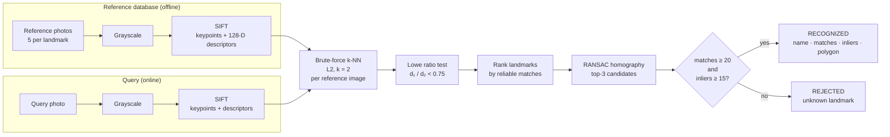

<div align="center">

# Landmark Recognition with SIFT

### Scale-invariant feature matching, geometric verification, and open-set rejection for landmark identification

<p>
<a href="https://colab.research.google.com/github/YOUR_GITHUB_USERNAME/YOUR_REPO_NAME/blob/main/Landmark_Recognition_SIFT.ipynb"></a>


</p>

<i>Five landmarks. Five photographs each. No training. A query photograph is identified, localized, or explicitly rejected, and every decision is backed by geometrically verified evidence.</i>

<br><br>


</div>

---

## Abstract

This project implements a landmark recognition system built entirely on hand-crafted local features. Reference photographs of the **Eiffel Tower, Taj Mahal, Colosseum, Statue of Liberty and Great Wall of China** are encoded as SIFT keypoints and 128-dimensional descriptors.

A query image is matched using exact Euclidean *k*-nearest-neighbour search (*k* = 2), filtered by Lowe's ratio test, and ranked per landmark. The leading candidates are then **geometrically verified** with a RANSAC-estimated homography. That homography also **localizes** the landmark by projecting the reference image's corners into the query.

A two-condition acceptance rule — minimum reliable matches **and** minimum RANSAC inliers — gives the system the ability to say *"I don't know"*. Images of landmarks absent from the database are rejected instead of being forced onto the closest class.

The system is evaluated under controlled, single-factor perturbations: rotation, scale, illumination and perspective. It is also tested on genuinely unseen photographs and an out-of-database landmark, with per-query evidence and timing recorded for every test.

---

## Contents

- [Highlights](#highlights)
- [Method](#method)
- [Design decisions](#design-decisions)
- [Experimental protocol](#experimental-protocol)
- [Results](#results)
- [Repository structure](#repository-structure)
- [Quick start](#quick-start)
- [Configuration](#configuration)
- [Limitations](#limitations)
- [References](#references)

---

## Highlights

| | |
|---|---|
| **Training-free** | Recognition comes from local-feature correspondence. No model is fitted, and a handful of photographs per landmark is enough. |
| **Interpretable** | Every decision can be traced to specific matched keypoints. The inliers are drawn on the image. |
| **Open-set** | Unknown landmarks are rejected by evidence thresholds, not assigned to the nearest class. |
| **Localizing** | A RANSAC homography projects the reference frame into the query. Degenerate transforms are detected and reported instead of drawn. |
| **Controlled evaluation** | Each synthetic condition changes exactly one factor, so any loss of evidence can be attributed to that factor. |
| **Reproducible** | Fixed seeds (including OpenCV's RANSAC RNG), cached data with a source manifest, and a single configuration cell. |

---

## Method



### 1. Scale-space keypoint detection

SIFT locates extrema of the Difference-of-Gaussians across space and scale:

$$D(x,y,\sigma) = \big(G(x,y,k\sigma) - G(x,y,\sigma)\big) * I(x,y)$$

Low-contrast candidates are rejected, and so are edge-like candidates, which satisfy

$$\frac{\operatorname{Tr}(\mathbf{H})^2}{\operatorname{Det}(\mathbf{H})} \ge \frac{(r+1)^2}{r}, \qquad r = 10.$$

### 2. Invariant description

Each keypoint is assigned a dominant gradient orientation, and its descriptor is computed relative to that orientation. A 4 × 4 grid of 8-bin orientation histograms gives 128 values.

- Measuring gradients relative to the dominant orientation gives **rotation invariance**.
- Sizing the descriptor window by the detected scale gives **scale invariance**.
- Unit-length normalization, clipping at 0.2 and re-normalization give **robustness to illumination change**.

### 3. Matching with Lowe's ratio test

For each query descriptor, the two nearest reference descriptors under the Euclidean norm are retrieved. A match is kept only if it is distinctly better than the runner-up:

$$\frac{\lVert \mathbf{q} - \mathbf{r}_{(1)} \rVert_2}{\lVert \mathbf{q} - \mathbf{r}_{(2)} \rVert_2} < \tau = 0.75$$

### 4. Geometric verification

A homography $\mathbf{H} \in \mathbb{R}^{3\times3}$ (8 DOF) is fitted with RANSAC using a 5 px reprojection threshold. A correspondence is an **inlier** if it agrees with the consensus transformation.

The number of iterations needed to sample one all-inlier minimal set with confidence $p$ is

$$N = \frac{\log(1-p)}{\log\!\left(1-w^{4}\right)},$$

where $w$ is the inlier ratio.

Coincidental matches almost never agree on a single projective transformation. That makes the inlier count a far more discriminative signal than the raw match count.

### 5. Decision and localization

The best verified candidate is accepted if and only if

$$\text{reliable matches} \ge T_m = 20 \quad\wedge\quad \text{RANSAC inliers} \ge T_i = 15.$$

The localization polygon is drawn only if the homography is also physically plausible:

- the determinant of its linear part is positive and bounded, so there is no reflection and no collapse;
- the projected quadrilateral is convex;
- the projected region covers a non-trivial area;
- the projected corners stay near the image.

Otherwise, the system reports that localization is unreliable.

---

## Design decisions

These are the choices a reviewer is most likely to question, with the reasoning behind each.

**Matching against each reference image, not a pooled database.**
With pooled descriptors, a correct match's second-nearest neighbour is often a *different photo of the same landmark*. The ratio test would then discard the match precisely because the landmark is well represented. Matching per image avoids this, and it also gives one geometrically consistent reference for homography estimation.

**Landmark score = best reference, not the sum over references.**
A photograph shows one viewpoint. Summing over references would reward landmarks that simply have more photos.

**Two thresholds instead of the largest match count.**
A ranking always has a winner, even when the correct answer is *none of these*. The inlier threshold is what turns a classifier into a recognizer with a reject option.

**Thresholds fixed in advance.**
$T_m$ and $T_i$ were set from the expected level of chance matches before evaluation. The threshold-sensitivity curve in the notebook is *descriptive*. It is deliberately not used to tune the thresholds on the test set.

**CPU execution.**
OpenCV's SIFT and brute-force matcher run on the CPU in standard builds, so a GPU adds nothing. Reported timings therefore reflect the algorithm, not accelerator overhead.

---

## Experimental protocol

Every landmark is tested under every condition. That gives **30 known-landmark queries plus 2 out-of-database queries**.

| Condition | Construction | Property under test |
|---|---|---|
| Original | Reference image #1, unmodified | Pipeline sanity / upper bound |
| Rotated | 45° rotation on an enlarged canvas (nothing cropped) | Rotation invariance |
| Resized | 50 % area-interpolated downscaling | Scale invariance |
| Low brightness | Intensities × 0.35 | Illumination robustness |
| Viewpoint (synthetic) | Projective warp of the top corners | Controlled perspective change |
| Viewpoint (real photo) | Held-out photograph never placed in the database | Real-world generalization |
| Unknown landmark | Sydney Opera House photographs | Open-set rejection |

**Recorded for every query:** predicted landmark, number of keypoints, reliable matches, RANSAC inliers, localization validity, decision, correctness, and processing time (extraction + matching + verification; rendering excluded).

**Evaluation outputs:** a per-test results table, a per-condition summary, a confusion matrix with an explicit *Rejected* column, an evidence-strength plot against both thresholds, keypoint and latency profiles, and a threshold-sensitivity curve.

---

## Results

<!--
  Fill this section from your own run:
  outputs/experimental_results.csv and the summary tables in Sections 11–12 of the notebook.
  Report only numbers produced by the notebook.
-->

### Summary

| Metric | Value |
|---|---|
| Recognition accuracy on known landmarks | — / 30 |
| Rejection rate on the unknown landmark | — / 2 |
| False rejections (known → rejected) | — |
| Confusions (known → wrong landmark) | — |
| Median processing time per query (CPU) | — s |

### Per-condition results

| Condition | Correct | Mean keypoints | Mean reliable matches | Mean inliers | Mean time (s) |
|---|---|---|---|---|---|
| Original | | | | | |
| Rotated | | | | | |
| Resized | | | | | |
| Low brightness | | | | | |
| Viewpoint (synthetic) | | | | | |
| Viewpoint (real photo) | | | | | |
| Unknown landmark | | | | | |

### Visual results

<table>
<tr>
<td width="50%"><br><sub><b>SIFT keypoints on the reference database.</b> Circle radius = scale, radial line = orientation.</sub></td>
<td width="50%"><br><sub><b>Evidence strength per condition.</b> Each point is one query; dashed lines are the acceptance thresholds.</sub></td>
</tr>
<tr>
<td width="50%"><br><sub><b>Confusion matrix</b> including the reject option.</sub></td>
<td width="50%"><br><sub><b>Threshold sensitivity.</b> The trade-off between recognizing genuine views and rejecting unknown landmarks.</sub></td>
</tr>
</table>

### Observations

<!-- Replace with what your table actually shows. Expected behaviour from theory, for orientation: -->

- **Rotation and scale.** These are expected to retain a large share of the original evidence. Invariance is built into the descriptor's orientation normalization and the scale-space search.
- **Low brightness.** This is expected to reduce the number of *detected keypoints* more than it degrades matching. The descriptor is normalized, but the DoG contrast threshold is absolute. Comparing the keypoint column with the match column separates the two effects.
- **Real viewpoint change.** This is expected to be the hardest known condition. Viewpoint, lighting, season and occlusion change simultaneously, and a homography only approximates a 3-D structure.
- **Unknown landmarks.** These can accumulate a non-trivial number of ratio-test survivors from generic local patterns. Those matches do not agree geometrically, so they fail the inlier threshold.

---

## Repository structure

```
.
├── Landmark_Recognition_SIFT.ipynb   # complete implementation, analysis and discussion
├── README.md
├── landmark_db/                      # reference database, one folder per landmark
│   ├── Colosseum/                    #   ref_01.jpg … ref_05.jpg
│   ├── Eiffel_Tower/
│   ├── Great_Wall_of_China/
│   ├── Statue_of_Liberty/
│   └── Taj_Mahal/
├── queries/
│   ├── holdout/                      # one unseen photo per landmark (real viewpoint test)
│   └── unknown/                      # landmark not in the database
└── outputs/
    ├── experimental_results.csv      # per-query results table
    ├── sift_descriptor_database.npz  # labelled descriptors + keypoint geometry
    ├── image_manifest.csv            # source URL and licence page of every image
    └── screenshots/                  # one composite figure per test + analysis plots
```

---

## Quick start

**Google Colab (recommended)**

1. Click **Open in Colab** at the top of this page.
2. Keep the default **CPU** runtime.
3. Choose **Runtime → Run all**.

On the first run, freely licensed photographs are downloaded from Wikimedia Commons. They are cached for later runs.

**Using your own photographs**

1. Place them in `MyDrive/landmark_lab/` using the layout shown above.
2. Set `DATA_SOURCE = 'drive'` in the configuration cell.
3. Run all.

Landmark names are read from the folder names, so any set of five or more landmarks works.

**Local execution**

```bash
pip install opencv-python numpy pandas matplotlib requests jupyter
jupyter notebook Landmark_Recognition_SIFT.ipynb
```

---

## Configuration

All parameters live in one cell. Each has a stated justification in the notebook.

| Parameter | Default | Role |
|---|---|---|
| `MAX_IMAGE_DIM` | 800 | Longest image side; bounds the O(N<sub>q</sub>·N<sub>r</sub>) matching cost |
| `SIFT_N_FEATURES` | 2000 | Strongest keypoints retained per image |
| `LOWE_RATIO` | 0.75 | Ratio-test threshold τ |
| `MIN_GOOD_MATCHES` | 20 | Acceptance threshold T<sub>m</sub> |
| `MIN_INLIERS` | 15 | Acceptance threshold T<sub>i</sub> |
| `RANSAC_REPROJ_THRESHOLD` | 5.0 px | Inlier tolerance |
| `TOP_K_VERIFY` | 3 | Candidates receiving geometric verification |
| `SEED` | 42 | NumPy and OpenCV RNG seed |

---

## Limitations

- **Planar model, 3-D world.** A homography is exact only for planar scenes or pure camera rotation. Large viewpoint changes of curved or deep structures misclassify true correspondences as outliers. A fundamental-matrix model is the general alternative.
- **The Great Wall is not one object.** Different sections share little specific texture. Category-level identity is better captured by learned global descriptors.
- **Repetitive structure.** Arches, lattices and battlements produce ambiguous features that the ratio test removes, which reduces the available evidence.
- **Small evaluation set.** One held-out image per landmark means a single test moves accuracy by several points. The results characterize behaviour; they are not tight statistical estimates.
- **Linear scaling.** Brute-force matching grows linearly with database size. Scaling to thousands of landmarks would require approximate search (FLANN / HNSW) or a visual vocabulary, followed by verification of a shortlist.

**Natural extensions:** CLAHE before detection for low light, RootSIFT descriptors, fundamental-matrix verification, view-clustered references, and learned retrieval followed by SIFT re-ranking.

---

## References

1. D. G. Lowe. *Distinctive Image Features from Scale-Invariant Keypoints.* International Journal of Computer Vision, 60(2):91–110, 2004.
2. D. G. Lowe. *Object Recognition from Local Scale-Invariant Features.* Proc. IEEE ICCV, pp. 1150–1157, 1999.
3. M. A. Fischler and R. C. Bolles. *Random Sample Consensus: A Paradigm for Model Fitting with Applications to Image Analysis and Automated Cartography.* Communications of the ACM, 24(6):381–395, 1981.
4. R. Hartley and A. Zisserman. *Multiple View Geometry in Computer Vision*, 2nd ed. Cambridge University Press, 2004.
5. R. Arandjelović and A. Zisserman. *Three Things Everyone Should Know to Improve Object Retrieval.* Proc. IEEE CVPR, 2012.
6. OpenCV Documentation: Feature Detection and Description, Feature Matching + Homography. https://docs.opencv.org/4.x/

**Image credits.** Reference and query photographs are from [Wikimedia Commons](https://commons.wikimedia.org) under their respective free licences. The author and licence page of each file is listed in `outputs/image_manifest.csv`.

---

<div align="center">

**Ali Sher Ahmad**
BS Artificial Intelligence · COMSATS University Islamabad, Wah Campus
*Introduction to Computer Vision, Lab Assignment: Landmark Recognition using SIFT*

</div>
