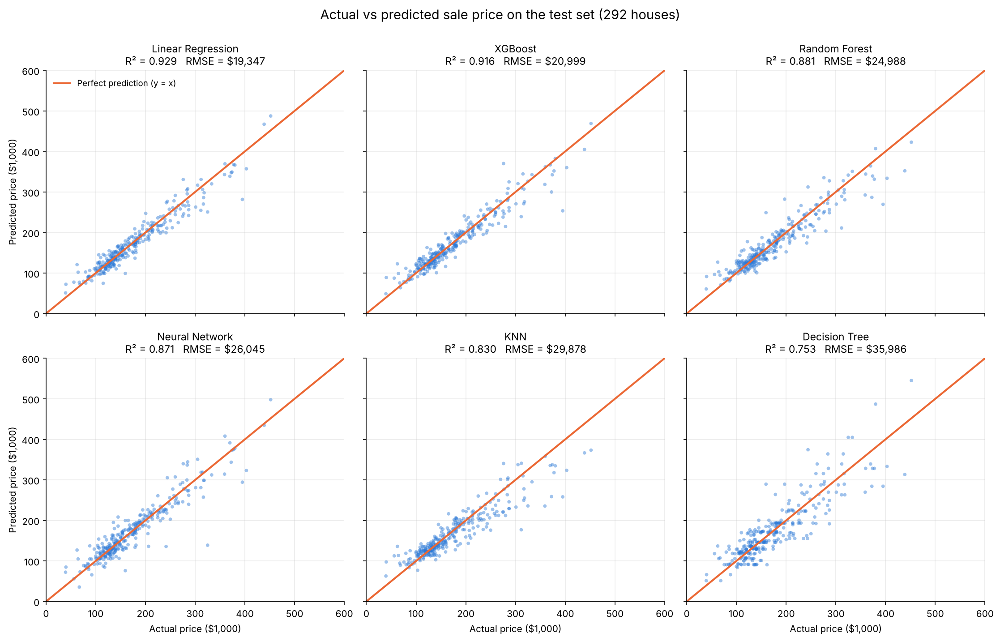
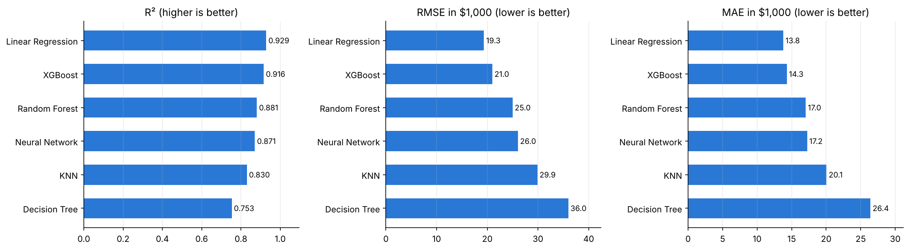
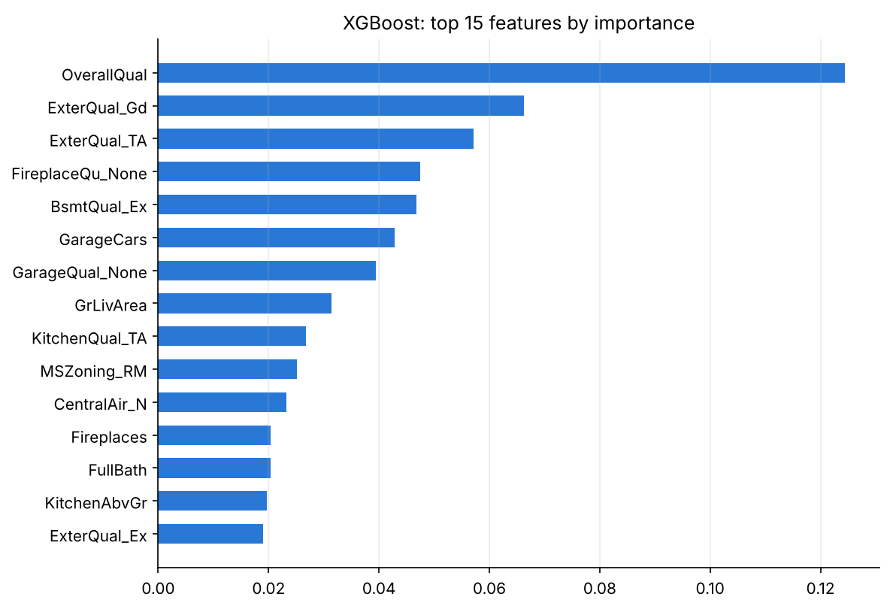

# Comparative Implementation of ML Regression Algorithms: Ames House Prices

[](https://colab.research.google.com/github/alisherahmad/ml-regression-ames-housing/blob/main/House_Price_Regression_Ames.ipynb)

Six regression algorithms are trained on the same house-price prediction problem and compared fairly:
**Linear Regression, Decision Tree, Random Forest, Neural Network (MLP), XGBoost and K-Nearest Neighbors.**

**Result:** Linear Regression performs best (R² = 0.929, RMSE = $19,347), with XGBoost a close second (R² = 0.916).

## Dataset

**Ames Housing** (the Kaggle *House Prices: Advanced Regression Techniques* dataset), loaded directly from [OpenML](https://www.openml.org/d/42165), so you don't need to download anything.

- 1,460 houses sold in Ames, Iowa between 2006 and 2010
- 79 features: 36 numeric (e.g. `OverallQual`, `GrLivArea`, `GarageCars`, `YearBuilt`) and 43 categorical (e.g. `Neighborhood`, `KitchenQual`)
- **Target:** `SalePrice` in US dollars (mean ≈ $181,000)

## Preprocessing

All steps are fitted on the training set only, so no test data leaks in.

1. **Drop** the 4 columns that are more than 80% empty (`PoolQC`, `MiscFeature`, `Alley`, `Fence`) and the `Id` column.
2. **Remove 4 outliers:** houses with more than 4,000 sq ft of living area, as the dataset's author recommends.
3. **Split 80:20** with `random_state=42`: 1,164 training houses and 292 test houses. All six models use exactly these rows.
4. **Numeric features:** fill missing values with the median, and apply `log(1 + x)` to the 19 strongly skewed ones (e.g. `LotArea`, `GrLivArea`).
5. **Categorical features:** fill missing values with `"None"` (a missing value here usually means "no garage" or "no basement"), then one-hot encode. Categories seen fewer than 10 times are grouped. This gives 241 model inputs in total.
6. **Scaling:** `StandardScaler` for Linear Regression, the Neural Network and KNN. Tree models don't need it.
7. **Target:** every model is trained on `log(1 + SalePrice)` because prices are right-skewed (skew 1.88). Predictions are converted back to dollars before scoring, so **all metrics are in real dollars**.

## Models

| Model | Key settings |
| --- | --- |
| Linear Regression | OLS |
| Decision Tree | `max_depth=8`, `min_samples_leaf=5` |
| Random Forest | 300 trees |
| Neural Network | `MLPRegressor`, hidden layers (64, 32), ReLU, Adam, L2 `alpha=1.0`, early stopping |
| XGBoost | 1,000 trees, `learning_rate=0.03`, `max_depth=4`, `subsample=0.8`, `colsample_bytree=0.6` |
| KNN | `k=7` (chosen by 5-fold CV), distance-weighted |

## Results (test set, 292 houses)

| Rank | Model | MAE | MSE | RMSE | R² |
| --- | --- | --- | --- | --- | --- |
| 1 | **Linear Regression** | **$13,787** | **3.74 × 10⁸** | **$19,347** | **0.9287** |
| 2 | XGBoost | $14,295 | 4.41 × 10⁸ | $20,999 | 0.9160 |
| 3 | Random Forest | $17,036 | 6.24 × 10⁸ | $24,988 | 0.8810 |
| 4 | Neural Network | $17,238 | 6.78 × 10⁸ | $26,045 | 0.8708 |
| 5 | KNN | $20,054 | 8.93 × 10⁸ | $29,878 | 0.8299 |
| 6 | Decision Tree | $26,410 | 1.30 × 10⁹ | $35,986 | 0.7533 |

MSE is in dollars squared. RMSE and MAE are easier to read: they're the typical error per house in dollars.

**5-fold cross-validation R² on the training set** (robustness check):

| Model | CV R² (mean ± std) |
| --- | --- |
| Linear Regression | 0.917 ± 0.009 |
| XGBoost | 0.912 ± 0.020 |
| Random Forest | 0.877 ± 0.019 |
| KNN | 0.817 ± 0.025 |
| Neural Network | 0.793 ± 0.087 |
| Decision Tree | 0.780 ± 0.020 |

### Actual vs predicted



### Metric comparison



### Feature importance (XGBoost)



## Why Linear Regression wins here

1. **After the log transforms, the relationship is close to linear.** Log-price rises roughly in a straight line with overall quality, log living area, garage size and so on, which is exactly what a linear model fits.
2. **The dataset is small.** With only 1,164 training houses, a simple low-variance model generalises better. XGBoost fits the training data almost perfectly (train R² 0.996) but drops to 0.916 on the test set; Linear Regression's gap is much smaller (0.953 to 0.929).
3. **The result is stable.** Linear Regression has the highest cross-validation score (0.917) and the smallest spread across folds (± 0.009).

XGBoost is a very close second and would likely overtake it on a larger dataset or with more tuning. With 20,640 houses (the California Housing dataset), XGBoost was clearly the best model.

| Algorithm | Strength | Limitation |
| --- | --- | --- |
| Linear Regression | Fast, interpretable, low variance | Needs good preprocessing (log transforms, encoding); can't model interactions on its own |
| Decision Tree | Easy to explain as if-then rules | High variance; lowest accuracy here |
| Random Forest | Robust to noise; little tuning needed | Less accurate than boosting; large model |
| Neural Network | Flexible non-linear learner | Unstable on small data (largest CV spread); needs tuning |
| XGBoost | Strong accuracy, built-in regularisation | Overfits small data without careful tuning |
| KNN | Simple, no training phase | Struggles with 241 dimensions; needs scaling |

## How to run

**Google Colab (easiest):** click the **Open in Colab** badge above, then choose *Runtime → Run all*. It takes about 1–2 minutes and needs internet access to download the dataset from OpenML.

**Locally:**

```bash
git clone https://github.com/alisherahmad/ml-regression-ames-housing.git
cd ml-regression-ames-housing
pip install -r requirements.txt
jupyter notebook House_Price_Regression_Ames.ipynb
```

## Repository structure

```
ml-regression-ames-housing/
├── House_Price_Regression_Ames.ipynb   # full code with outputs
├── images/                             # plots generated by the notebook
├── requirements.txt
└── README.md
```

## Author

Ali Sher Ahmad, BS Artificial Intelligence, COMSATS University Islamabad, Wah Campus
